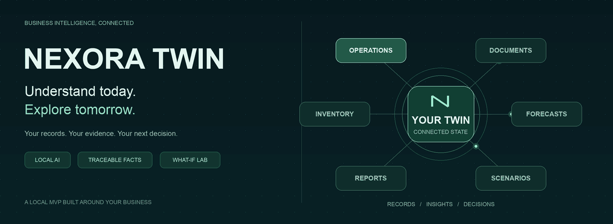
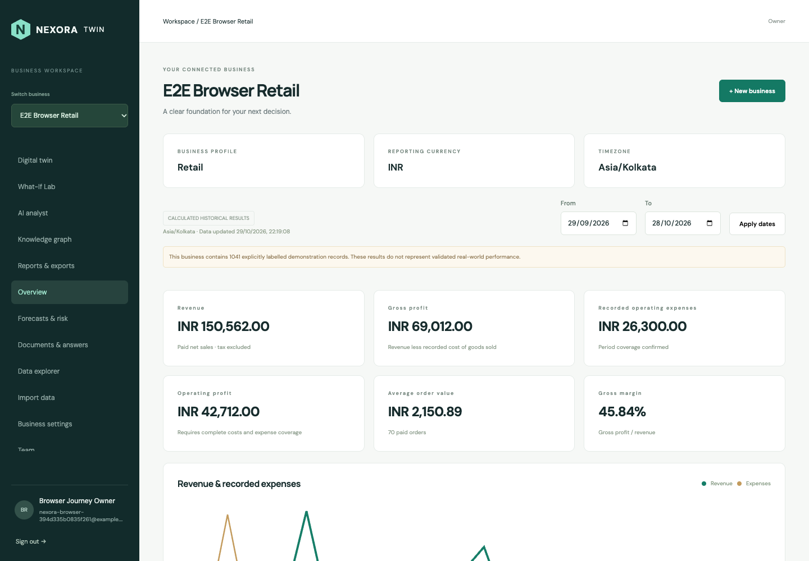

<div align="center">

<picture>
  <source media="(prefers-reduced-motion: reduce)" srcset="docs/assets/nexora-hero.png">
  
</picture>

# NEXORA TWIN

### Understand Your Business. Simulate Your Future.

**Turn business records into traceable insights, local AI answers and reviewed what-if scenarios.**

<a href="https://github.com/lavkeshraj03/NEXORA-TWIN/actions/workflows/ci.yml"></a>


[Quick start](#quick-start) · [Product tour](#product-tour) · [Local AI](#local-ai-on-this-mac) · [Demo data](#demo-data) · [Verification](#verification) · [Documentation](#documentation-and-limits)

</div>

---

## Your business, connected

NEXORA TWIN is a **local multi-business decision intelligence MVP**. Import your operational records, reconcile the numbers, ask questions of your documents, inspect evaluated models and explore hypothetical decisions from saved business states.

Each business has its own memberships, roles and data. The verified AI profile runs on a laptop with small local models—no paid model API or fine-tuning is required.

| From your records… | …to a useful next step |
| --- | --- |
| **Orders, costs and expenses** | Source-calculated revenue, margins, profit and reporting coverage |
| **Business documents** | Local document answers with exact supporting excerpts |
| **Recorded sales history** | Evaluated sales/demand forecasts and customer-inactivity estimates |
| **Saved business snapshots** | Reproducible history, captured sources and period comparisons |
| **Reviewed assumptions** | Price/cost/demand scenarios, sensitivity and stock/cash calculations |
| **Business questions** | Bounded analyst investigations with an evidence trail |
| **Linked source records** | A navigable knowledge graph built from recorded relationships |
| **Saved results** | Seven report types with CSV and paginated PDF exports |

**Daily workflow:** `Import → Reconcile → Forecast → Simulate → Investigate → Export`

Updates follow saved/imported records and explicit refreshes. Automatic POS, bank and online-store integrations are not included in this release.

## Product tour



<sub>Actual application screenshot from end-to-end acceptance. All displayed business records are synthetic demonstration data.</sub>

<details>
<summary><strong>What has been verified?</strong></summary>

- **167 backend tests** and **37 frontend tests**, plus strict TypeScript.
- **Nine live HTTP workflows** and **14 authenticated browser stages**.
- Real local embeddings, cited answers and image-only PDF OCR.
- All **seven report families** downloaded as CSV/PDF; seven PDFs parsed in strict mode.
- Tenant/role boundaries, immutable evidence, provider-failure behaviour and cleanup of isolated test data.

These are measured local acceptance results, not production certification or a claim of general model accuracy. See the [full end-to-end report](docs/end-to-end-verification.md).

</details>

---

## Quick start

For a fresh checkout, create .env as below. Preserve an existing .env and its database volumes during upgrades.

Install Docker Desktop with Compose v2. Use Node 22 and Python 3.12+ for native development. Leave several GB of disk space and RAM available; the application and local models share this laptop.

```sh
cp .env.example .env
# Edit .env and set a unique POSTGRES_PASSWORD before initializing PostgreSQL.
docker compose up --build -d
docker compose ps
python3 scripts/validate_environment.py
```

Open **http://localhost:3000/login**. Register, create an empty business and select its currency/timezone. A teammate registers their own account before an owner adds them in Team. No invitation email is sent. API documentation: http://localhost:8000/api/docs in development.

Ports 3000, 8000, 55432 and 56379 bind only to loopback. FRONTEND_PORT, BACKEND_PORT, POSTGRES_PORT and REDIS_PORT can change host ports; update ALLOWED_ORIGINS when changing the browser origin. Compose applies migrations before starting the API. Stop using `docker compose down`; persisted volumes remain. Do not remove volumes to troubleshoot.

## Local AI on this Mac

The verified profile uses **qwen3:1.7b** for answers and **qwen3-embedding:0.6b** for indexing/retrieval. It requires no paid API or fine-tuning. Install these models in native Ollama and set the AI variables described in [local AI setup](docs/local-ai.md), then:

```sh
sh scripts/start_local_ai.sh
sh scripts/start_local_ocr.sh
docker compose up -d backend worker frontend
```

The OCR helper uses macOS Vision; it is not a Linux-container service. Native helpers must be started again after reboot. The API and worker must use the same provider URL/model settings. Changing provider identity requires explicit document re-indexing. If AI is unavailable, document answers and analyst investigations report the failure; dashboards, numerical models, snapshots, scenarios and existing ordinary reports continue to work.

## Demo data

**A fresh installation starts empty.** Create a separate INR retail demo business and follow [demo setup](docs/deployment.md#fresh-labelled-demonstration) to load the synthetic package in [datasets/nexa-demo](datasets/nexa-demo). The loader checks ownership and refuses to mix demo records into a nonempty business.

The maintainer's local **Nexa** workspace already has the expanded demo, including saved scenarios, investigations and seven reports. If you are using that installation, select Nexa and follow the [walkthrough](docs/nexa-demo-guide.md). For **29 September–28 October 2026**, its synthetic example reconciles to revenue INR 150,562, gross profit INR 69,012, recorded expenses INR 26,300 and operating profit INR 42,712.

Try these screens in order:

1. **Overview / Data explorer:** inspect totals and the records behind them.
2. **Documents & answers:** select the returns policy and ask how long a customer has to return an item; inspect its citation.
3. **Forecasts & risk:** inspect saved demo models and their evaluation; use the labelled demonstration scope.
4. **Digital twin / What-If Lab:** open the October baseline, inspect sources and compare the saved price-change assumptions.
5. **AI analyst:** review an existing investigation and its calculated/document evidence.
6. **Knowledge graph:** search a SKU and inspect stored relationships and source records.
7. **Reports & exports:** open one of the seven saved reports and download its CSV or PDF.

For real records, use **Import data** to upload, map, validate and explicitly confirm your files. Keep real records in a separate business from the demonstration package.

## Verification

```sh
python3 -m venv backend/.venv
backend/.venv/bin/python -m pip install -c backend/requirements.lock -e './backend[test]'
cd backend
.venv/bin/alembic upgrade head
RUN_INTEGRATION=1 .venv/bin/python -m pytest -q
.venv/bin/alembic check
```

From `frontend/`, run `npm ci`, `npm test`, `npm run typecheck` and `npm run build`. Native API development uses `uvicorn app.main:app --host 127.0.0.1 --port 8000`; frontend development uses `npm run dev`. Keep the RQ worker in Docker on macOS. Native database/Redis URLs must use host ports; Compose services use internal hostnames.

After building the Compose images, run the isolated release acceptance from the repository root:

```sh
backend/.venv/bin/python scripts/verify_fresh_install.py
```

This requires Docker access, free ports 3001/8001/55433/56380, backend test dependencies and configured local AI. It creates a randomly named separate project, migrates empty volumes, runs the backend suite and real HTTP graph/report/PDF checks, loads synthetic data twice, trains saved numerical models, indexes documents and checks live cited answers. It removes only its own temporary project and writes a receipt under `.local/`. It does not reset Nexa. Optional NEXORA_TEST_BACKEND points to a local source copy if macOS Desktop offloading stalls reads.

With Chrome installed, `node scripts/verify_browser.cjs` checks login/home keyboard navigation, accessibility-tree landmarks and mobile overflow. Set CHROME_BIN for a different Chrome/Chromium binary, or NEXORA_BASE_URL for another local frontend. Screenshots and a receipt are written to .local/. This is limited browser coverage, not a WCAG audit.

## Documentation and limits

[Architecture](docs/architecture.md), [API reference](docs/api-reference.md), [database schema](docs/database-schema.md), [security](docs/security.md), [deployment/recovery](docs/deployment.md), [forecasting](docs/forecasting-api.md), [snapshots](docs/digital-twin-api.md), [simulation methodology](docs/simulation-methodology.md), [analyst](docs/analyst-api.md), [graph/reports](docs/graph-reports-api.md).

This release is a local MVP. It does not claim enterprise production readiness, independently validated model accuracy, universal document understanding or complete industry ERP modules. Review evidence and model limitations before decisions. Production requires TLS, least-privilege database roles, operational backups/restore, retention, content isolation/antivirus, broader accessibility and load/security evaluation. PDF text uses standard fonts with escaped fallback for unsupported Unicode; CSV preserves Unicode.

## Complete start-to-finish acceptance

After building the app images and configuring local AI/OCR, run from the repository root:

```sh
backend/.venv/bin/python scripts/verify_fresh_install.py --all-flows
```

This starts a disposable installation, runs the complete backend suite, then verifies identity/team access, imports and financial totals, all five document formats, scanned-PDF OCR, local cited answers, sales/demand/inactivity models, snapshots, scenarios, analyst evidence/failures, graph relationships and report exports through the real frontend proxy. Chrome then exercises a continuous authenticated browser journey, including six CSV confirmations, training, snapshot/scenario comparisons, all seven CSV/PDF report downloads, settings, tenant switching, team permissions, mobile layout and logout/relogin.

Requires an installed Chrome/Chromium binary (CHROME_BIN can override its path), native Node 22+, configured real local AI/OCR and free acceptance ports 3001/8001/8002/55433/56380. Tests use synthetic data and remove only their own isolated project. The exact registration counter in that disposable Redis is cleared between independent workflows; the main application's Redis is untouched. Receipts/screenshots/downloads are written under .local/e2e/. A browser-only rerun is available with --browser-only.

---

<div align="center">

**Understand today. Explore tomorrow.**

[Read the architecture](docs/architecture.md) · [Explore the API](docs/api-reference.md) · [Review the evidence](docs/end-to-end-verification.md)

<sub>Original animated artwork lives in this repository. Regenerate it with <code>python3 scripts/generate_readme_animation.py</code> after installing the optional Pillow package.</sub>

</div>
